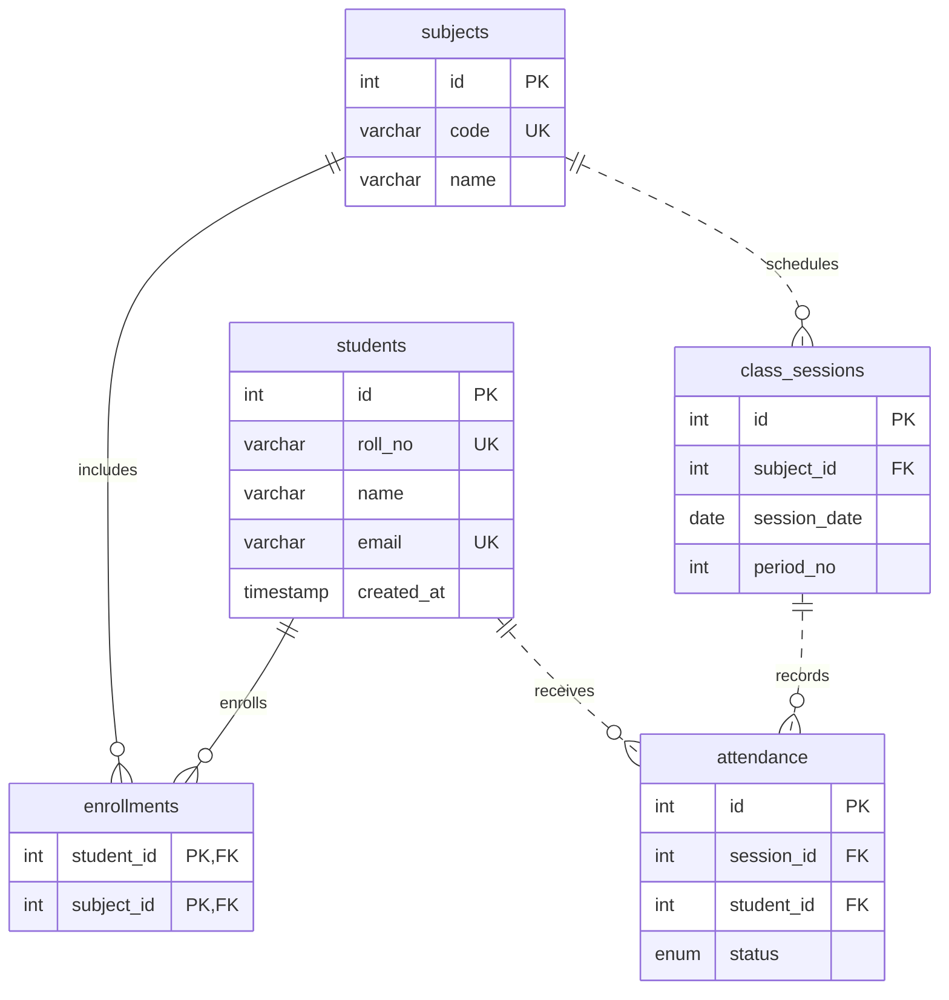
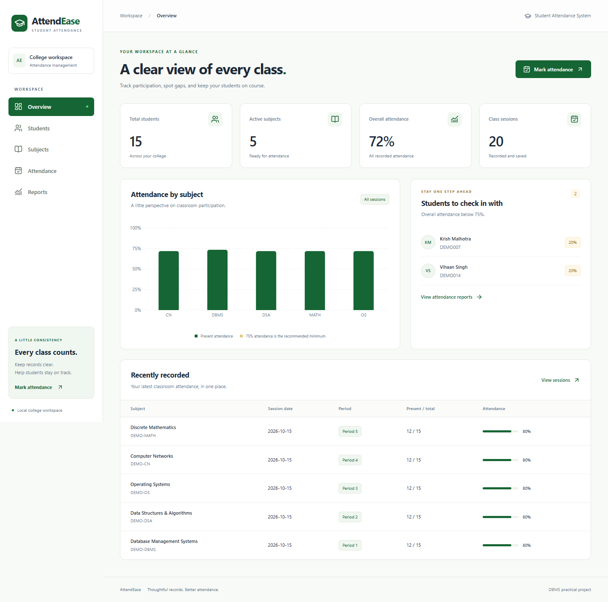

# AttendEase — Student Attendance Management System

A local college DBMS project with a responsive ivory and forest-green dashboard and a real MySQL database. All running statistics and records come from MySQL; there is no fake-data fallback.

**[Open the deployed application](https://attendease-techtroop.vercel.app/dashboard)** · Vercel Authentication may require you to sign in. Hosted MySQL currently uses an Aiven trial service. See [deployment details](docs/VERCEL_DEPLOYMENT.md).

## Features

- Dashboard: student/subject counts, weighted overall attendance, subject chart, recent sessions, and students below 75%.
- Students: add, edit, delete with confirmation, search name/roll, view details, and manage enrollments.
- Subjects: CRUD, enrollment counts, and student enrollment controls.
- Attendance: subject/date/period register, Present/Absent, mark all present, complete-roster validation, duplicate prevention, and editing existing sessions.
- Reports: detailed student/subject records, SQL summaries by student or subject, filters, below-75% view, counts, and progress bars.
- Accessible native dialogs, keyboard controls, responsive tables, reduced-motion support, and useful validation/database errors.

## Stack and architecture

Next.js App Router, React, TypeScript, Tailwind CSS, Lucide React, Recharts, Zod, MySQL 8 and mysql2/promise. Raw prepared SQL is used instead of an ORM. UI components fetch JSON from local route handlers. Database code is server-only and uses a connection pool. Zod validates requests before prepared queries execute. Attendance saves and enrollment changes use transactions.

```text
app/                     Five application pages and shared layout
app/api/[...path]/       Small API router with validated endpoints
components/              Shell, dialogs, CRUD directory and shared UI
lib/                     Pool, report SQL, validation and shared types
database/                Schema, repeatable seed and viva SQL
scripts/                 Private credential setup and verification scripts
tests/                   Attendance validation tests
docs/                    Viva guide and screenshots
```

## Database design

All five tables use InnoDB. The schema uses primary keys, unique keys, foreign keys, indexes and a period CHECK constraint (1–12).



Enrollments resolves the many-to-many relationship between students and subjects. Sessions are unique per subject/date/period; attendance is unique per session/student. Attendance membership is validated inside the API transaction against locked enrollment data.

**Deletion:** deleting a student cascades to their enrollments and attendance; deleting a subject cascades to its enrollments, sessions and attendance. Unenrollment preserves historical attendance. New enrollees have no invented historical absences. Existing session corrections require the complete current enrolled roster and preserve records of students who have since unenrolled.

**Calculation:** present ÷ recorded attendance × 100. SQL NULLIF handles zero records; the UI displays No records and excludes these cases from below-75% lists. Weighted summaries sum present and total counts instead of averaging percentages.

For the complete verified entity and attribute descriptions, report-ready PNG/SVG exports, and editable Mermaid source, see [docs/ER_DIAGRAM.md](docs/ER_DIAGRAM.md). Solid lines identify relationships whose foreign key participates in the child's primary key; dashed lines identify the other foreign-key relationships.

## Windows installation

Install Node.js 20.9+ and MySQL 8.0.16+ (for enforced CHECK constraints). Ensure the MySQL service is running. This project does not install or modify system services.

```powershell
cd C:\Users\yashv\attendease
npm.cmd install
npm.cmd run db:configure
npm.cmd run db:setup
npm.cmd run db:seed
npm.cmd run db:check
npm.cmd run dev
```

Open http://127.0.0.1:3000. The root redirects to /dashboard. On Windows, npm.cmd avoids PowerShell's npm.ps1 execution-policy restriction.

### Credentials

`db:configure` prompts privately in your terminal and creates gitignored `.env.local`. It refuses to replace an existing file. Never paste passwords into chat or commit them. Alternatively, edit a copy of `.env.example` locally and supply DB_HOST, DB_PORT, DB_USER, DB_PASSWORD and DB_NAME. DB_NAME is attendease; no variable is public or exposed to client components.

Setup needs permission to create the attendease database/tables; normal use needs SELECT, INSERT, UPDATE and DELETE. The integration rollback test temporarily creates a subject-scoped trigger, so its test user additionally needs TRIGGER privilege. No global server configuration is changed.

### Schema and seed

`database/schema.sql` creates the database and five tables with IF NOT EXISTS. It never drops data and does not migrate incompatible pre-existing tables. `database/seed.sql` inserts 15 fictional students, 5 subjects, 75 enrollments, 20 sessions and 300 attendance records on a fresh database. It checks natural keys to avoid accumulating duplicates. Existing student/subject fields and existing session statuses are not overwritten. Demo records use DEMO rolls/codes and example.com addresses. Re-running the seed restores missing demo enrollment pairs; avoid reseeding if intentionally changing demo membership.

### Commands

| Command                  | Purpose                                          |
| ------------------------ | ------------------------------------------------ |
| npm.cmd run dev          | Development server, loopback only                |
| npm.cmd run build        | Production build                                 |
| npm.cmd start            | Serve the production build at 127.0.0.1:3000     |
| npm.cmd run typecheck    | TypeScript checks                                |
| npm.cmd run lint         | ESLint                                           |
| npm.cmd test             | Attendance validation tests                      |
| npm.cmd run test:api     | Live API/MySQL scenarios; server must be running |
| npm.cmd run test:browser | Headless Edge workflow and responsive checks     |
| npm.cmd run db:check     | Connection, schema and row counts                |
| npm.cmd run format       | Format source for readability                    |

Test records use unique identifiers and are cleaned up. API tests check transaction rollback with an intentional second-row failure. Browser tests use the installed Microsoft Edge and check all five pages at phone, tablet and desktop widths. Do not run the API and browser tests concurrently.

## API

| Endpoint                         | Methods                      | Purpose                                                              |
| -------------------------------- | ---------------------------- | -------------------------------------------------------------------- |
| /api/students, /api/students/:id | GET, POST / GET, PUT, DELETE | Student CRUD and enrollment detail                                   |
| /api/subjects, /api/subjects/:id | GET, POST / GET, PUT, DELETE | Subject CRUD and enrollment detail                                   |
| /api/enrollments                 | POST, DELETE                 | Enroll or unenroll                                                   |
| /api/sessions                    | GET                          | Recent sessions or register by subject_id/session_date/period_no     |
| /api/attendance                  | POST, PUT                    | Create complete session or edit by session_id                        |
| /api/dashboard                   | GET                          | SQL dashboard aggregates                                             |
| /api/reports                     | GET                          | Optional student_id, subject_id, group=students/subjects, below=true |
| /api/health                      | GET                          | Live connection check                                                |

Local commands bind to 127.0.0.1. For the optional Vercel deployment with a separate hosted MySQL database, follow [docs/VERCEL_DEPLOYMENT.md](docs/VERCEL_DEPLOYMENT.md). The app has no application login: anyone with access can edit its records, so use fictional demo data and Vercel deployment protection when restricted access is needed.

## Workbench and sample SQL

Open a local Workbench connection using your private credentials. Select attendease and execute:

```sql
SELECT * FROM students ORDER BY id DESC LIMIT 5;

SELECT s.roll_no,sub.code,cs.session_date,cs.period_no,a.status
FROM attendance a JOIN students s ON s.id=a.student_id
JOIN class_sessions cs ON cs.id=a.session_id
JOIN subjects sub ON sub.id=cs.subject_id
ORDER BY cs.id DESC,s.roll_no;

SELECT sub.code,COUNT(a.id) recorded,
       ROUND(100.0*SUM(a.status='Present')/NULLIF(COUNT(a.id),0),1) percentage
FROM subjects sub LEFT JOIN class_sessions cs ON cs.subject_id=sub.id
LEFT JOIN attendance a ON a.session_id=cs.id GROUP BY sub.id;
```

See [database/viva-queries.sql](database/viva-queries.sql) for all required SQL examples and safely rolled-back demonstration writes. Read [docs/VIVA.md](docs/VIVA.md) for explanations and 15 likely viva questions.

## Screenshots

The browser verification script generates actual desktop and phone captures:



[Phone dashboard](docs/screenshots/mobile.png)

## Troubleshooting

- **Database unavailable:** check the MySQL service, local credentials, port, and `npm.cmd run db:check`. Restart the app after editing .env.local.
- **Duplicate record:** rolls, emails, codes and session tuples must be unique. Load an existing attendance register to edit it.
- **Incomplete register:** mark every enrolled student. Enroll students on Students/Subjects first.
- **Port already in use:** stop the other local process or run `npm.cmd start -- --port 3001`.
- **Production build missing:** run `npm.cmd run build` before `npm.cmd start`.
- **PowerShell script restriction:** use npm.cmd; credential configuration uses a process-scoped execution-policy override and does not change system policy.
- **Schema mismatch:** setup preserves existing tables. Inspect a pre-existing schema before changing it; never drop unrelated data.
- **Test trigger permission:** use a local development account with TRIGGER permission for the rollback integration test.
- **npm audit:** the installed ESLint tooling dependency chain currently reports braces advisories. The proposed npm fix is a breaking downgrade of eslint-config-next. Runtime dependencies can be checked separately with `npm.cmd audit --omit=dev`; avoid force-downgrading the Next.js tooling.
