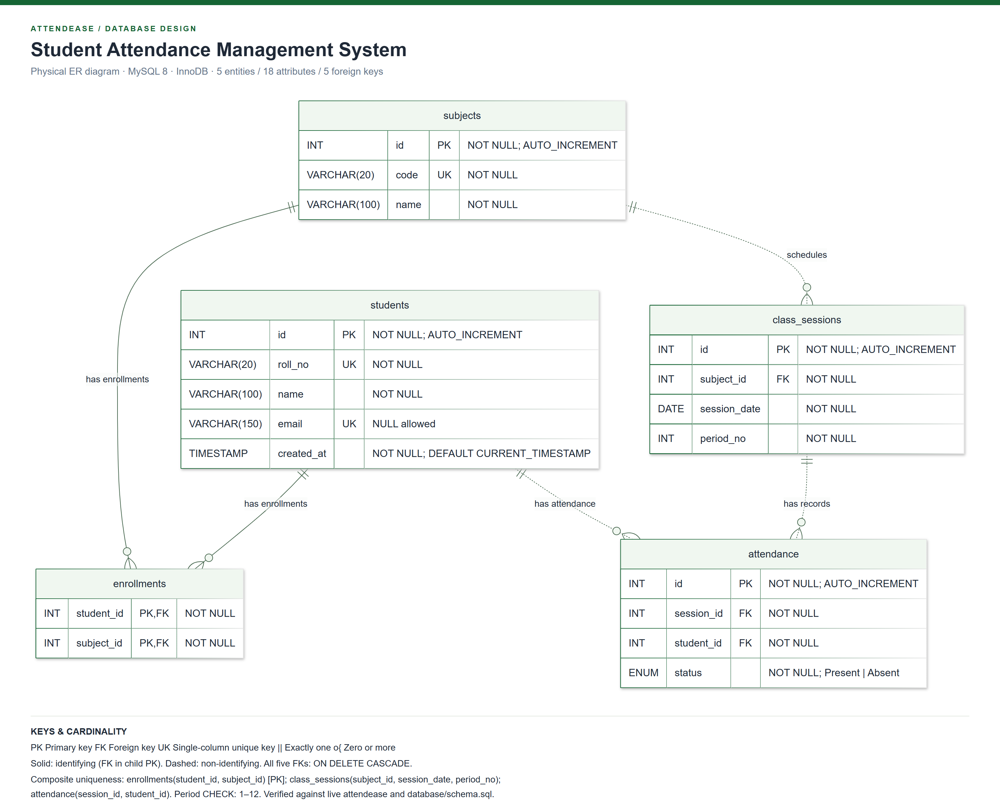
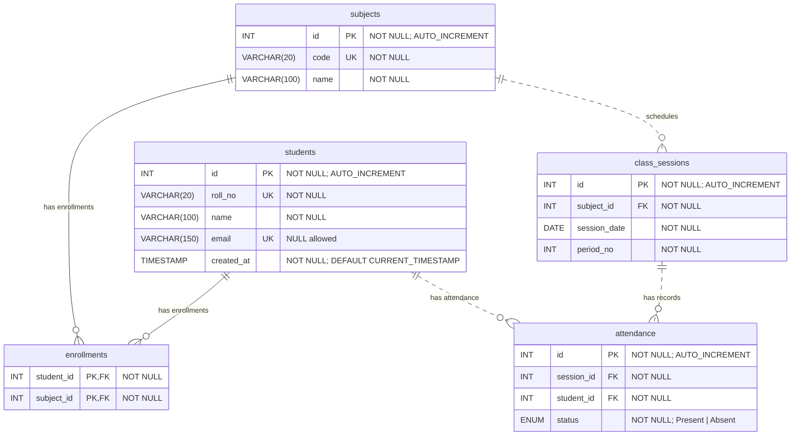

# AttendEase — Entity Relationship Diagram

This physical ER diagram documents the actual **attendease** MySQL database. Its five tables, 18 columns and five foreign keys were read from the running local database and compared with `database/schema.sql`. No database records or structures were modified during generation.

## Report-ready files

- [PNG — 3132 × 2532 pixels](diagrams/attendease-er.png): high-resolution image for a college report or presentation.
- [SVG — scalable vector diagram](diagrams/attendease-er.svg): preferred for printing and resizing without losing sharpness.
- [Mermaid source](diagrams/attendease-er.mmd): editable diagram definition.
- [Live schema metadata](diagrams/schema-verification.json): column, index, foreign-key and CHECK metadata, verification timestamp and SHA-256 of the SQL file.
- [Verification summary](diagrams/verification-summary.json): comparison results and export dimensions.
- [Offline Workbench import SQL](diagrams/attendease-schema.sql): actual SHOW CREATE TABLE definitions, without row data or credentials.



## Notation

**PK** identifies a primary-key column, **FK** a foreign-key column, and **UK** a single-column unique key. Both enrollment columns are marked PK because they form one composite primary key; neither column is independently unique. Composite unique constraints on sessions and attendance are stated below and in the diagram legend, rather than incorrectly marking their individual columns as unique.

Crow's-foot notation **`||`** means exactly one and **`o{`** means zero or more. A solid line indicates an identifying relationship: the parent's key participates in the child's primary key. A dashed line indicates a non-identifying relationship: the child has its own primary key independent of the foreign key. This follows [Mermaid's ER relationship notation](https://mermaid.js.org/syntax/entityRelationshipDiagram.html).

## Entities and attributes

### students

Stores student identity and contact information.

| Attribute  | Actual SQL type | Nullable? | Keys / default            |
| ---------- | --------------- | --------- | ------------------------- |
| id         | INT             | No        | PK; AUTO_INCREMENT        |
| roll_no    | VARCHAR(20)     | No        | UNIQUE                    |
| name       | VARCHAR(100)    | No        | —                         |
| email      | VARCHAR(150)    | Yes       | UNIQUE; default NULL      |
| created_at | TIMESTAMP       | No        | DEFAULT CURRENT_TIMESTAMP |

Roll numbers cannot repeat. MySQL permits multiple NULL values in a unique nullable email column; a supplied non-NULL email must be unique.

### subjects

Stores the subject catalog.

| Attribute | Actual SQL type | Nullable? | Keys / default     |
| --------- | --------------- | --------- | ------------------ |
| id        | INT             | No        | PK; AUTO_INCREMENT |
| code      | VARCHAR(20)     | No        | UNIQUE             |
| name      | VARCHAR(100)    | No        | —                  |

### enrollments

Resolves the many-to-many relationship between students and subjects and stores current subject membership.

| Attribute  | Actual SQL type | Nullable? | Keys                                   |
| ---------- | --------------- | --------- | -------------------------------------- |
| student_id | INT             | No        | Part of composite PK; FK → students.id |
| subject_id | INT             | No        | Part of composite PK; FK → subjects.id |

**Composite primary key:** `(student_id, subject_id)`. Each student–subject pair occurs at most once. One student may join several subjects and one subject may contain several students.

### class_sessions

Identifies an individual class by its subject, date and period.

| Attribute    | Actual SQL type | Nullable? | Keys / default                 |
| ------------ | --------------- | --------- | ------------------------------ |
| id           | INT             | No        | PK; AUTO_INCREMENT             |
| subject_id   | INT             | No        | FK → subjects.id               |
| session_date | DATE            | No        | Part of uq_session             |
| period_no    | INT             | No        | Part of uq_session; CHECK 1–12 |

**Composite UNIQUE constraint:** `uq_session(subject_id, session_date, period_no)`. This permits multiple periods on one date but prevents a duplicate session for the same subject/date/period. The subject_id column also participates in this composite key. No session attribute is individually unique except id.

**CHECK constraint:** `chk_period: period_no BETWEEN 1 AND 12`.

### attendance

Stores one student's attendance status for one class session.

| Attribute  | Actual SQL type          | Nullable? | Keys / default                                |
| ---------- | ------------------------ | --------- | --------------------------------------------- |
| id         | INT                      | No        | PK; AUTO_INCREMENT                            |
| session_id | INT                      | No        | FK → class_sessions.id; part of uq_attendance |
| student_id | INT                      | No        | FK → students.id; part of uq_attendance       |
| status     | ENUM('Present','Absent') | No        | Only these two status values                  |

**Composite UNIQUE constraint:** `uq_attendance(session_id, student_id)`. Each student can have at most one attendance row per session. The diagram uses ENUM as the type token and lists its exact values in the comment because Mermaid type tokens do not support SQL string literals and commas.

## Five database relationships

| Parent            | Child foreign key         | Cardinality from parent | Relationship type | Delete rule |
| ----------------- | ------------------------- | ----------------------- | ----------------- | ----------- |
| students.id       | enrollments.student_id    | One to zero or many     | Identifying       | CASCADE     |
| subjects.id       | enrollments.subject_id    | One to zero or many     | Identifying       | CASCADE     |
| subjects.id       | class_sessions.subject_id | One to zero or many     | Non-identifying   | CASCADE     |
| class_sessions.id | attendance.session_id     | One to zero or many     | Non-identifying   | CASCADE     |
| students.id       | attendance.student_id     | One to zero or many     | Non-identifying   | CASCADE     |

Every foreign key is NOT NULL, so **each child row references exactly one parent**. A parent can exist without child rows, hence zero-or-more on the child side. Application rules require a complete attendance roster when saving, but the foreign keys alone do not enforce a minimum number of attendance rows for a session.

The foreign keys specify no ON UPDATE action in the source DDL. The live database reports NO ACTION, which is restrictive for these InnoDB keys.

Deleting a student cascades to that student's enrollments and attendance. Deleting a subject cascades to its enrollments and sessions; deleting those sessions cascades to their attendance. Deleting an enrollment alone does not delete historical attendance.

**There is no foreign key from attendance to enrollments, nor a direct subject_id column in attendance.** A session supplies its subject through class_sessions.subject_id. The attendance API checks subject enrollment in its transaction. The diagram deliberately does not invent an enrollment–attendance database relationship. The conceptual many-to-many student–subject relationship is represented through enrollments rather than as an additional direct foreign-key line.

## Indexes

The live schema includes the primary and unique indexes above, plus:

- `enrollments.idx_enrollment_subject(subject_id)`.
- `class_sessions.idx_session_date(session_date)`.
- `attendance.idx_attendance_student(student_id)`.

All five tables use **InnoDB**, **utf8mb4**, and **utf8mb4_0900_ai_ci** collation. All INT columns are signed; there are no UNSIGNED columns in this schema.

## Mermaid definition



## Verification and reproduction

The local generator reads INFORMATION_SCHEMA and SHOW CREATE TABLE. It compares table names and InnoDB engines, column names/order, data types/lengths, nullability, defaults, AUTO_INCREMENT, primary keys, unique constraints, explicit supporting indexes, foreign-key mappings/delete/update rules, and the period CHECK with database/schema.sql. Generation stops if these comparisons fail. Mermaid source is generated from the verified metadata.

The PNG was rendered from the final SVG using installed Microsoft Edge through Playwright. Both exports were visually inspected for readable labels, cardinality markers and unclipped content. The SVG is self-contained and does not require a network connection to display. The PNG uses two pixels per SVG coordinate for sharp report output.

To regenerate with the same local database credentials already configured in .env.local:

```powershell
npm.cmd run diagram:er
```

No credentials or student records are included in the exported artifacts. The generator does not execute the accompanying DDL snapshot or change the live schema.

## Optional MySQL Workbench model

An automatic `.mwb` export was not produced. MySQL Workbench is installed, but its bundled Python executable failed to initialize as a standalone runtime (missing the `encodings` module). An existing Workbench session was left untouched. The PNG, SVG and Mermaid exports do not depend on Workbench.

The supplied [attendease-schema.sql](diagrams/attendease-schema.sql) is suitable for **offline model import**: in Workbench select **File → Import → Reverse Engineer MySQL Create Script**, choose the file, enable placement on a diagram, and save the resulting model as `.mwb`. This imports a model; it does not require running SQL against the live database. Do not use Forward Engineer or Synchronize for this task. Workbench's installed version may not represent every MySQL CHECK in the visual model; the verified SQL and documentation remain authoritative for those constraints.
